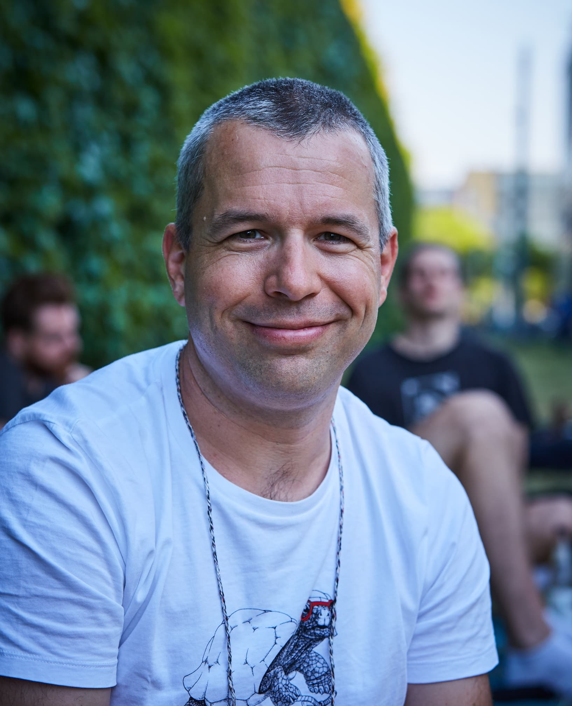

+++
title = "About Me"
+++

# About Me

<small>Photo: CC-BY 4.0 Florian »Cheatha« Köhler</small>

My name is Florian Posdziech. I'm a software
[developer](/categories/tech/ "blog articles from category tech"),
[musician](/categories/music/ "music-related blog posts"),
and athlete. I currently live in Mannheim, Germany and work as a backend developer
for [ioki](https://ioki.com/) in Frankfurt am Main.

I like reggae music, baseball, fish tacos, and beer. I've lived, studied and worked in the USA, Norway and Mexico.

Check my [Now page](/now) to see what I'm up to at the moment.

## What I do

### Music

I play the trombone in the Ska and Reggae band [_The Uplifters & Block Ice Horn Section_](https://theuplifters.de/konzerte) from Freiburg, and the 2-tone and Rocksteady band [_The Offbeat Service_](https://www.instagram.com/theoffbeatservice/) from Worms.

You can find dates for my next gigs on [the music page](/music).

### Training

At any time I train one or more of either running, kettlebelling, heavy club swinging, [CrossFit](https://www.muskeltiere-sport.de/), strength training, body building, or rucking.

### Coding

I do most of my coding for work, so the only public repository that I regularly
touch is my [Emacs config](https://codeberg.org/flowfx/emacs.d).

---

## More of my stuff on the interwebs

- [Several Ways To Live (in Mexico City)](https://severalwaystolive.com/)
- [Cultural Comments - der C3S-Podcast](https://podcast.c3s.cc/)
- [Florian Op Tour](https://florianoptour.de/)
- [flowfx @ Codeberg](https://codeberg.org/flowfx/)
